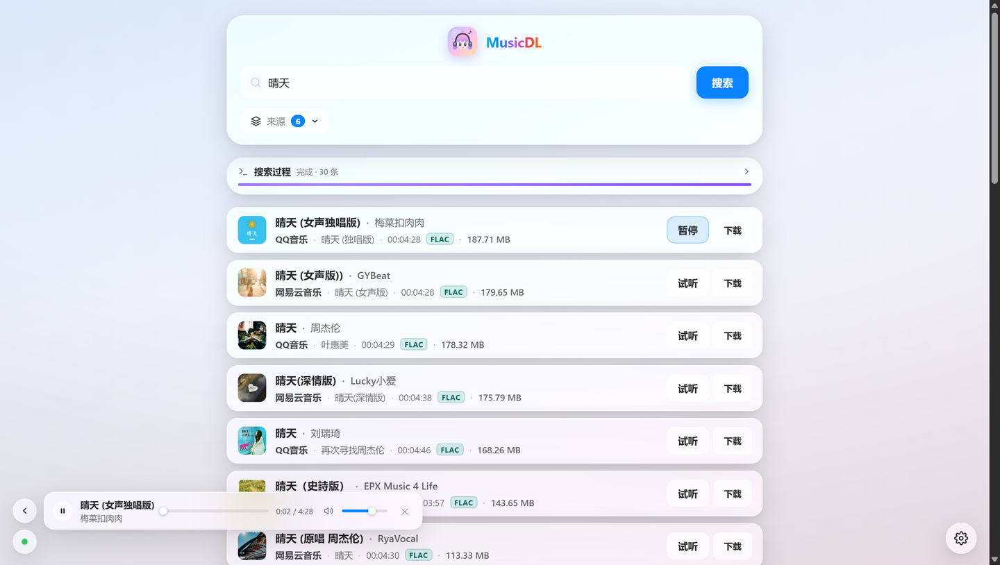
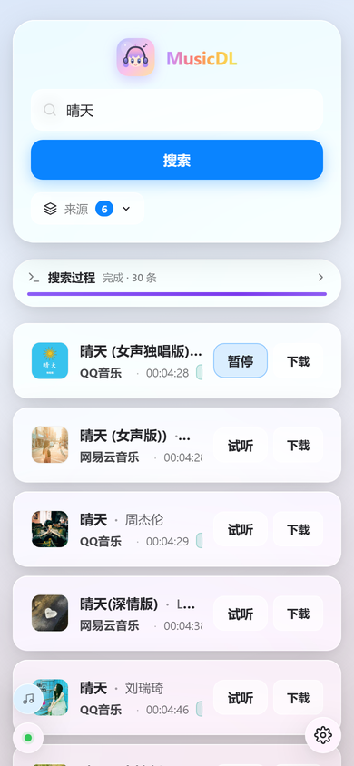

# MusicDL Web

给 [musicdl](https://github.com/CharlesPikachu/musicdl) 套了个网页壳。搜歌、试听、下载、翻歌词，全在浏览器里点。



> **这是 vibe coding 的产物。**
> 界面和大部分代码是跟 AI 你一句我一句聊出来的，没按严格工程规范写，能用、够用就行。
> 你要拿去正经用，建议自己再读一遍代码。

## 能干什么

- 多平台搜歌，50 多个源随便勾，哪个源挂了会直接告诉你
- 在线试听，有音量条和静音，进度能拖
- 下载，字节进度、转速环、日志都有
- 歌词机翻（任何 OpenAI 兼容接口，默认 `deepseek-flash`）
- 毛玻璃界面，手机上也正常

## 跑起来

**Docker：**

```bash
docker build -t musicdl-web:1.1 .

docker run -d --name musicdl-web -p 8000:8000 \
  -v "$PWD/downloads:/app/downloads" \
  -v "$PWD/.cache:/app/.cache" \
  musicdl-web:1.1
```

国内构建慢，加两个参数换源：

```bash
docker build --build-arg DEBIAN_MIRROR=mirrors.tuna.tsinghua.edu.cn \
             --build-arg PIP_INDEX_URL=https://pypi.tuna.tsinghua.edu.cn/simple \
             -t musicdl-web:1.1 .
```

**不想用 Docker：** 装好 Python 3.12 和 ffmpeg，然后

```bash
pip install musicdl==2.14.1
MUSICDL_PORT=8000 MUSICDL_OUTPUT=./downloads python app/web/server.py
```

Windows 直接双击不了，用 `powershell -ExecutionPolicy Bypass -File scripts/run-local.ps1`。

打开 <http://localhost:8000>，输中文歌名就行。

## 设置

右下角齿轮，三页：

| | |
|---|---|
| 背景 | 图片直链、模糊、亮度、面板透明度 |
| Cookie | 夸克网盘、TIDAL —— 填了才解锁对应来源 |
| AI 翻译 | API 地址、Key、模型、目标语言 |

都存 `/app/.cache`，挂卷就不会丢。

## 说明

- 搜索、解析、下载全是上游 [musicdl](https://github.com/CharlesPikachu/musicdl) 在干活，这边只是套壳。
- 上游是 **PolyForm Noncommercial 1.0.0**，所以这个项目也只能**非商业**使用。详见 [LICENSE](LICENSE)、[NOTICE](NOTICE)。
- 不存音乐文件，版权归各平台。

<details>
<summary>HTTP 接口</summary>

| 方法 | 路径 | 干什么 |
|---|---|---|
| GET | `/api/health` | 后端和 musicdl 是否就绪 |
| GET | `/api/sources` | 可用音乐源 |
| GET/POST | `/api/cookies` | 读 / 存凭证并重新探测 |
| GET/POST | `/api/ai` | 读 / 存 AI 配置；`/api/ai/test` 测试连接 |
| POST | `/api/search` · `/api/search/stream` | 搜索（后者 NDJSON 流式，带进度和日志） |
| GET | `/api/stream?id=` | 音频代理，转发 Range，给 `<audio>` 用 |
| GET | `/api/cover?id=` | 封面代理，只认本次搜索结果 |
| POST | `/api/download` · `/api/download/stream` | 下载 |

</details>

<details>
<summary>手机上的样子</summary>



</details>
