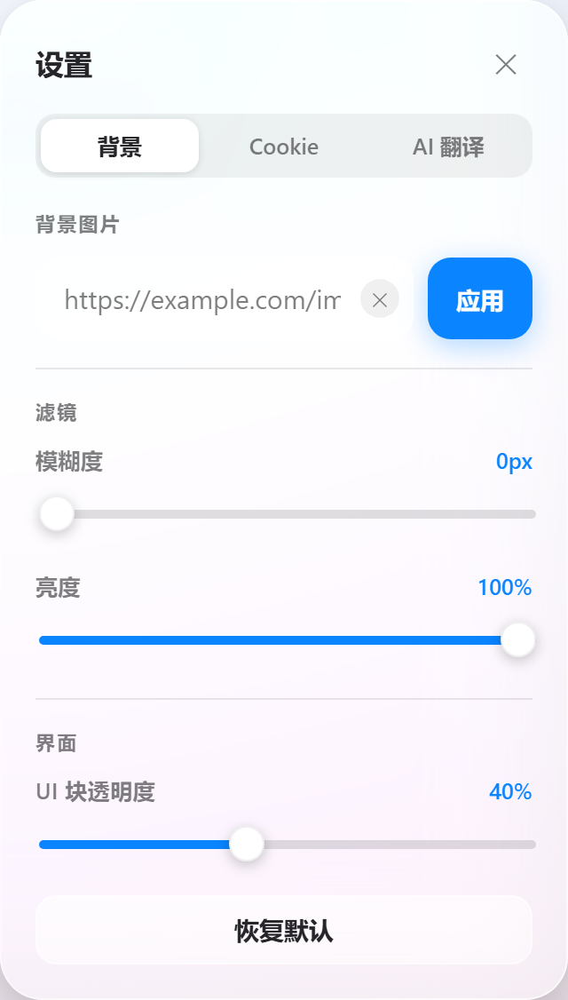
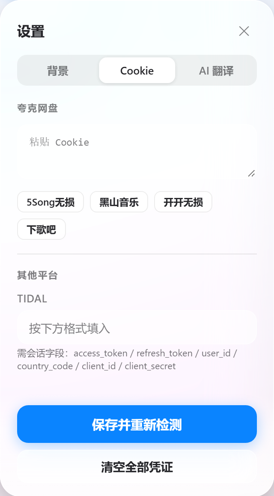
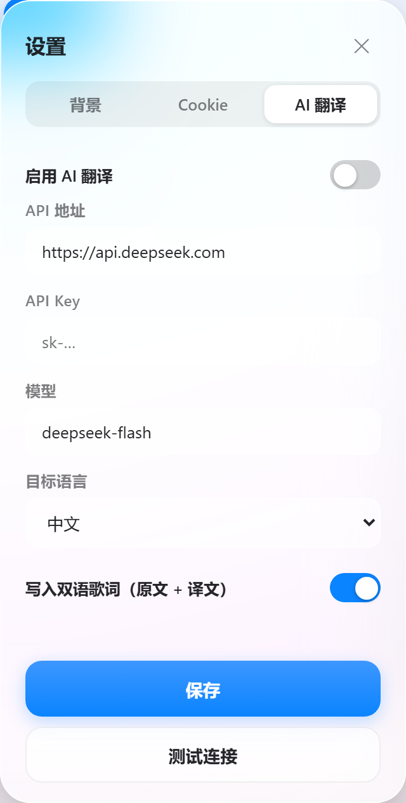

# MusicDL Web

> 给 [musicdl](https://github.com/CharlesPikachu/musicdl) 套一个好看的网页外壳：搜索、在线试听、下载、歌词翻译，全部在浏览器里完成。

**本项目是 [CharlesPikachu/musicdl](https://github.com/CharlesPikachu/musicdl) 的二次加工**：音乐源的抓取、解析、下载全部由上游 `musicdl` 库完成；本仓库提供的是 Web 前端 + 标准库后端（`app/web/`）、Docker 打包和界面。



---

## 特性

- **多来源聚合搜索**：默认注册 50+ 音乐源，勾选任意组合；结果按来源分组，实时显示每个源的进度与失败原因
- **在线试听**：浏览器内直接播放（后端代理音频流，支持 Range 拖动进度），带 **音量滑杆 + 静音**，音量记忆到 `localStorage`
- **下载**：服务端流式下载，前端实时显示字节进度、转速环和日志；下载完成自动整理文件名
- **AI 歌词翻译**：任意 OpenAI 兼容接口（DeepSeek / OpenAI / Ollama / 中转站），翻译 LRC 并写入音频标签，可选双语歌词
- **玻璃拟态 UI**：毛玻璃面板、渐变背景、可分页的设置面板（背景 / Cookie / AI），移动端适配，支持 `prefers-reduced-motion`
- **看板娘图标**：手绘 SVG 二次元头像，兼作 favicon（SVG + PNG + ICO）
- **优雅降级**：`musicdl` 依赖缺失时页面照常打开，搜索/下载返回明确错误，方便排查环境

<table>
<tr>
<td></td>
<td></td>
</tr>
</table>

---

## 快速开始

### Docker（推荐）

```bash
git clone https://github.com/youzzx/musicdl-web.git
cd musicdl-web

docker build -t musicdl-web:1.0 .

docker run -d --name musicdl-web \
  -p 8000:8000 \
  -v "$PWD/downloads:/app/downloads" \
  -v "$PWD/.cache:/app/.cache" \
  musicdl-web:1.0
```

打开 <http://localhost:8000>。

国内网络可以换源构建：

```bash
docker build \
  --build-arg DEBIAN_MIRROR=mirrors.tuna.tsinghua.edu.cn \
  --build-arg PIP_INDEX_URL=https://pypi.tuna.tsinghua.edu.cn/simple \
  -t musicdl-web:1.0 .
```

或者用 compose：

```bash
docker compose up -d --build
```

### 本地直接跑（Windows / macOS / Linux）

需要 Python 3.12 和 ffmpeg。

```bash
python -m venv .venv
source .venv/bin/activate        # Windows: .venv\Scripts\activate
pip install musicdl==2.14.1

# 打包 web 目录里的后端直接跑
MUSICDL_HOST=127.0.0.1 MUSICDL_PORT=8000 MUSICDL_OUTPUT=./downloads \
  python app/web/server.py
```

Windows 下可以直接用脚本：

```powershell
powershell -ExecutionPolicy Bypass -File scripts/run-local.ps1
```

---

## 配置

设置面板（右下角齿轮）分三页：

| 分页 | 内容 |
|---|---|
| 背景 | 背景图直链、模糊度、亮度（0–100）、UI 块透明度 |
| Cookie | 夸克网盘 Cookie（解锁 4 个夸克来源）、TIDAL 会话字段 |
| AI 翻译 | 启用开关、API 地址、Key、模型（默认 `deepseek-flash`）、目标语言、双语歌词 |

凭证保存在 `/app/.cache/credentials.json`，AI 配置保存在 `/app/.cache/ai-config.json`，都落在挂载卷里，重建容器不丢。

### 环境变量

| 变量 | 默认 | 说明 |
|---|---|---|
| `MUSICDL_HOST` | `0.0.0.0` | 监听地址 |
| `MUSICDL_PORT` | `8000` | 监听端口 |
| `MUSICDL_OUTPUT` | `/app/downloads` | 下载目录 |
| `MUSICDL_CACHE` | `/app/.cache` | 凭证 / AI 配置 / 日志目录 |

---

## HTTP 接口

| 方法 | 路径 | 说明 |
|---|---|---|
| GET | `/` | 前端页面 |
| GET | `/api/health` | 后端与 `musicdl` 依赖状态 |
| GET | `/api/sources` | 可用音乐源（含缺凭证的来源） |
| GET | `/api/cookies` | 凭证配置与缺失清单 |
| POST | `/api/cookies` | 保存凭证并重新探测 |
| GET | `/api/ai` | AI 翻译配置（`api_key` 只返回掩码） |
| POST | `/api/ai` · `/api/ai/test` | 保存 / 测试连接 |
| POST | `/api/search` | 聚合搜索（一次性返回） |
| POST | `/api/search/stream` | 聚合搜索（NDJSON 流式：进度 + 日志 + 结果） |
| GET | `/api/stream?id=` | 音频代理（转发 Range，供 `<audio>` 试听） |
| GET | `/api/cover?id=` | 封面代理（仅限本次搜索结果，防开放代理） |
| POST | `/api/download` · `/api/download/stream` | 下载（流式版本带字节进度） |

---

## 目录结构

```
.
├── app/web/                # 后端 + 前端静态资源（容器里就是 /app/web）
│   ├── server.py           # 标准库 HTTP 服务（无框架依赖）
│   ├── translator.py       # AI 歌词翻译（OpenAI 兼容）
│   ├── scraper.py          # 剧集/专辑封面等抓取辅助
│   ├── tagger.py           # 音频标签读写（ffmpeg / mutagen）
│   └── static/             # index.html / style.css / app.js / 图标
├── scripts/
│   ├── run-local.ps1       # Windows 本地启动
│   └── build-image.py      # 没有 Docker 时按 docker save 规范打镜像
├── docs/                   # 截图
├── Dockerfile
├── docker-compose.yml
├── LICENSE                 # PolyForm Noncommercial 1.0.0
└── upstream/               # 上游项目的许可证原文
```

---

## 常见问题

**搜索结果为空 / 大量来源失败？**
先看 `/api/health`。若 `ready:false`，说明容器里 `musicdl` 没装上（本地跑最常见），按上面步骤 `pip install musicdl==2.14.1`。若只有少数来源失败，多半是这些源需要 Cookie（设置面板 Cookie 页会列出）。

**能在线试听但没有声音？**
浏览器自动播放策略：先点一下页面再点试听。音量在播放栏里调，静音后图标会变成静音样式。

**下载很慢？**
速度取决于该来源的 CDN 与本地网络；下载面板会显示已接收字节和实时速度。

---

## 许可与致谢

- 上游 **[CharlesPikachu/musicdl](https://github.com/CharlesPikachu/musicdl)** —— 采用 **PolyForm Noncommercial License 1.0.0**（版权 © 2018–2026 CharlesPikachu），原文见 [upstream/LICENSE-musicdl](upstream/LICENSE-musicdl)。
- 本项目（Web 界面与后端）作为它的二次加工，遵循同样的 **PolyForm Noncommercial 1.0.0**，**仅限非商业用途**，详见 [LICENSE](LICENSE) 与 [NOTICE](NOTICE)。
- 本工具不存储、不传播音乐文件本身，仅做下载代理；音乐版权归各平台与版权方所有，请勿用于商业用途或大规模抓取。

## 免责声明

本项目仅供学习与个人使用。使用本工具产生的任何后果由使用者自行承担，与作者无关。请遵守所在地区的法律法规以及各音乐平台的服务条款。
